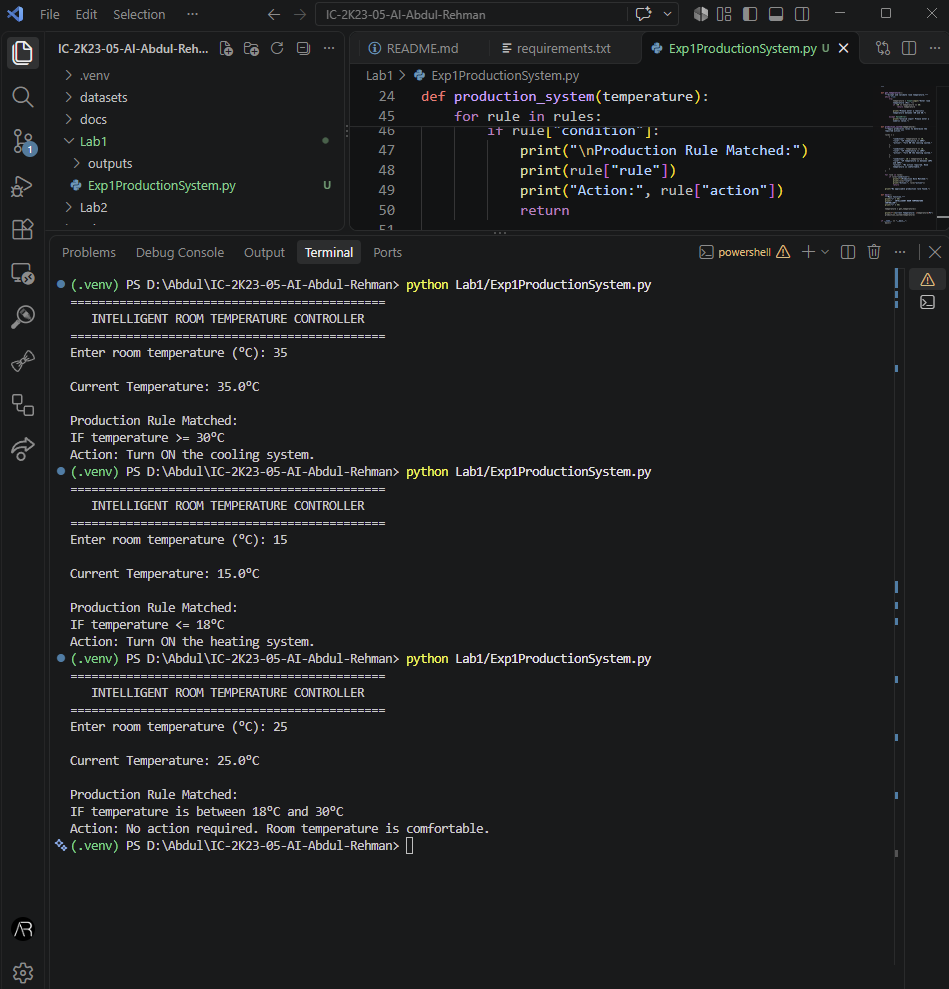
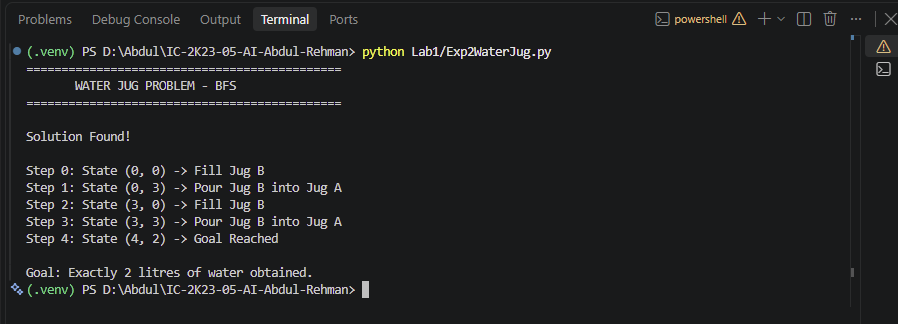
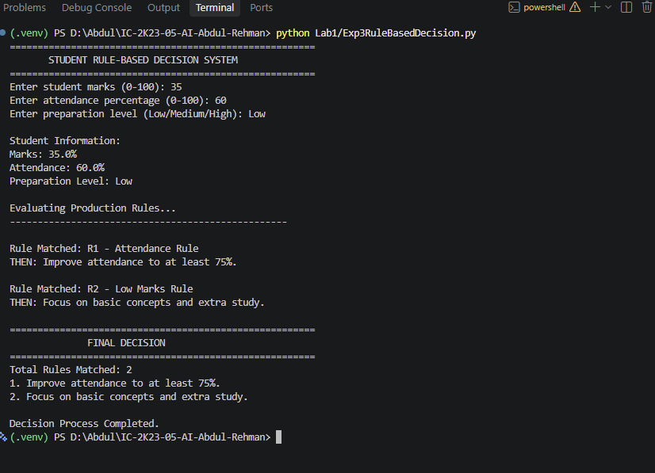

# Lab 1: AI Problem Formulation and Intelligent Problem Solving

## Overview

This laboratory session focuses on fundamental Artificial Intelligence problem-solving techniques, including Production Systems, State Space Representation, Breadth First Search (BFS), and Rule-Based Decision Making.

The experiments demonstrate how AI systems represent problems, explore possible states, apply logical rules, and make decisions to achieve specific goals.

## Experiments

| Experiment | Title                      | Technique               |
| ---------- | -------------------------- | ----------------------- |
| 1          | Production System          | IF-THEN Rules           |
| 2          | Water Jug Problem          | State Space Search, BFS |
| 3          | Rule-Based Decision Making | Rule-Based Reasoning    |

---

## Experiment 1: Production System

### Aim

To implement a simple Production System in Python using IF-THEN rules for an intelligent room temperature controller.

### Problem Statement

Develop a rule-based system that accepts the current room temperature and decides whether to activate the cooling system, heating system, or take no action.

### Algorithm

1. Accept the current room temperature.
2. Validate the temperature input.
3. Define production rules for different temperature conditions.
4. Compare the current temperature with the predefined rules.
5. Execute the matching rule.
6. Display the corresponding action.

### Production Rules

| Condition                         | Action                 |
| --------------------------------- | ---------------------- |
| Temperature >= 30°C               | Turn ON cooling system |
| Temperature <= 18°C               | Turn ON heating system |
| Temperature between 18°C and 30°C | No action required     |

### Execution

```bash
python Lab1/Exp1ProductionSystem.py
```

### Results / Output

The system successfully evaluates the room temperature and executes the corresponding production rule.

### Output Screenshot



### Performance Analysis

- Time Complexity: O(R), where R is the number of production rules.
- Space Complexity: O(R), for storing the rules.
- The system evaluates rules sequentially until a matching rule is found.

### Learning Outcomes

- Understood the concept of Production Systems.
- Learned how to represent knowledge using IF-THEN rules.
- Understood the role of rule matching and decision-making.
- Implemented a simple rule-based intelligent system.

---

## Experiment 2: Water Jug Problem

### Aim

To solve the Water Jug Problem using Breadth First Search (BFS) and State Space Representation.

### Problem Statement

There are two water jugs with capacities of 4 litres and 3 litres. The objective is to obtain exactly 2 litres of water in either jug using the permitted operations.

### State Representation

A state is represented as:

`(A, B)`

Where:

- A represents the current amount of water in the 4-litre jug.
- B represents the current amount of water in the 3-litre jug.

Initial State: `(0, 0)`

Goal State: Any state where A = 2 or B = 2.

### Allowed Operations

1. Fill Jug A.
2. Fill Jug B.
3. Empty Jug A.
4. Empty Jug B.
5. Pour water from Jug A into Jug B.
6. Pour water from Jug B into Jug A.

### Algorithm

1. Initialize both jugs as empty.
2. Insert the initial state into a BFS queue.
3. Remove the first state from the queue.
4. Check whether the target quantity has been obtained.
5. Generate all possible next states using the allowed operations.
6. Ignore previously visited states.
7. Add valid new states to the queue.
8. Repeat until the goal state is reached.
9. Display the solution path.

### Execution

```bash
python Lab1/Exp2WaterJug.py
```

### Results / Output

The BFS algorithm successfully finds a sequence of operations to obtain exactly 2 litres of water in the 4-litre jug.

The solution requires 6 operations.

### Output Screenshot



### Performance Analysis

- Time Complexity: O(V + E), where V represents explored states and E represents transitions between states.
- Space Complexity: O(V), for the BFS queue and visited states.
- BFS finds the minimum number of operations when all operations have equal cost.

### Learning Outcomes

- Understood State Space Representation.
- Learned the working of Breadth First Search.
- Implemented queue-based search.
- Learned how to avoid repeated state exploration using a visited set.

---

## Experiment 3: Rule-Based Decision Making

### Aim

To implement a Student Decision Support System using predefined IF-THEN rules in Python.

### Problem Statement

Develop a rule-based system that accepts student marks, attendance percentage, and preparation level to generate suitable academic recommendations.

### Input Parameters

- Student marks (0–100).
- Attendance percentage (0–100).
- Preparation level (Low, Medium, High).

### Knowledge Base

| Rule | Condition                          | Recommendation          |
| ---- | ---------------------------------- | ----------------------- |
| R1   | Attendance < 75%                   | Improve attendance      |
| R2   | Marks < 40                         | Focus on basic concepts |
| R3   | Marks >= 40 and < 70               | Practice more questions |
| R4   | Marks >= 70 and preparation = Low  | Revise regularly        |
| R5   | Preparation = Medium               | Improve preparation     |
| R6   | Marks >= 70 and preparation = High | Maintain performance    |

### Algorithm

1. Accept student marks, attendance, and preparation level.
2. Validate all input values.
3. Store the input information in working memory.
4. Define predefined IF-THEN rules in the knowledge base.
5. Evaluate each rule using the inference engine.
6. Store all matching rules.
7. Display the matched rules and corresponding recommendations.

### Execution

```bash
python Lab1/Exp5RuleBasedDecision.py
```

### Results / Output

The system successfully evaluates student information and generates academic recommendations based on all matching rules.

### Output Screenshots



### Performance Analysis

- Time Complexity: O(R), where R is the number of predefined rules.
- Space Complexity: O(R), for storing rules and matched recommendations.
- The inference engine evaluates each rule sequentially.

### Learning Outcomes

- Understood Rule-Based Knowledge Representation.
- Learned the role of a Knowledge Base and Inference Engine.
- Implemented multiple IF-THEN rules.
- Understood how multiple rules can generate multiple conclusions.
- Learned how to develop a basic decision support system.

---

## Overall Learning Outcomes

After completing all five experiments, the following concepts were understood and implemented:

1. Production Systems and IF-THEN rules.
2. State Space Representation and problem formulation.
3. Breadth First Search for solving AI problems.
4. Rule-Based Reasoning and Decision Making.
5. Input validation and modular Python programming.

## Technologies Used

- Python 3.14.7
- Python Standard Library
- Visual Studio Code

## How to Run the Experiments

Navigate to the repository root and activate the virtual environment:

```powershell
.\.venv\Scripts\Activate.ps1
```

Run any experiment using:

```powershell
python Lab1/Exp1ProductionSystem.py
python Lab1/Exp2WaterJug.py
python Lab1/Exp3RuleBasedDecision.py
```

No third-party Python packages are required for these five experiments.

---

**Laboratory:** Lab 1  
**Subject:** Artificial Intelligence Lab  
**Course Code:** IC-709D  
**Program:** Master of Computer Applications (MCA)  
**Institution:** International Institute of Professional Studies (IIPS), DAVV, Indore
