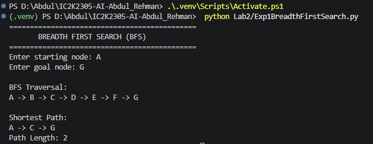
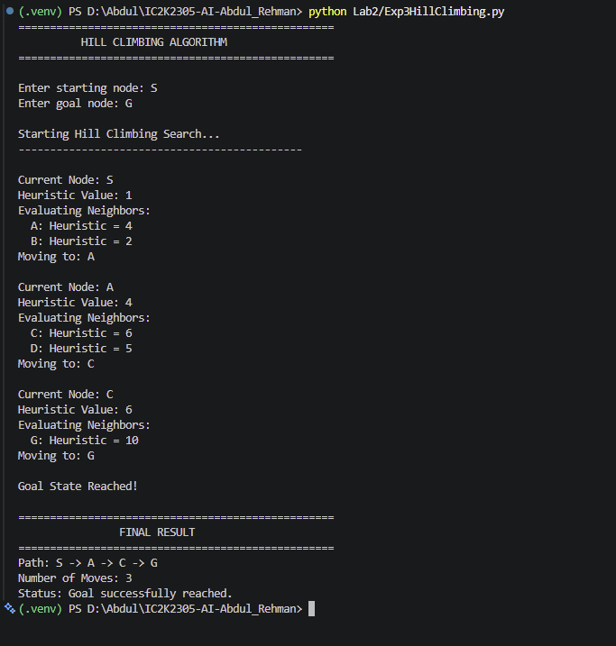
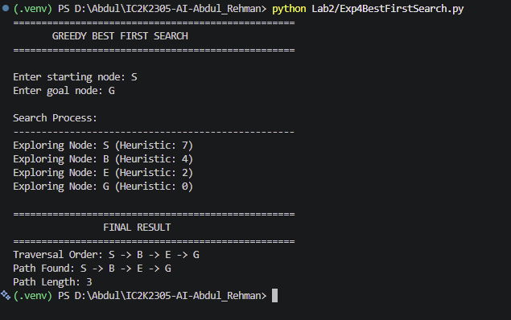
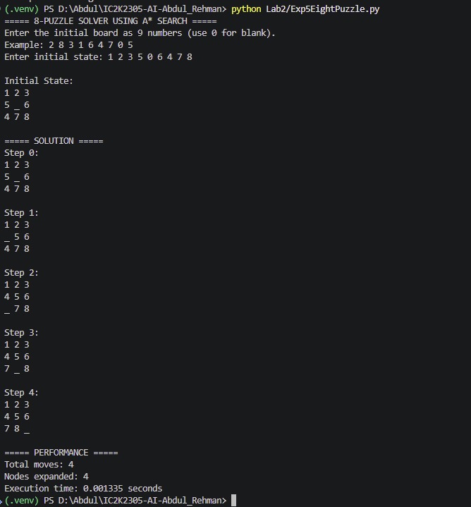

# Lab 2: Search Algorithms and Problem Solving

## Aim

To study and implement different search algorithms used in Artificial Intelligence for solving state-space problems, graph traversal, and finding solutions to problems.

## Experiments

### Experiment 1: Breadth First Search (BFS)

**File:** `Exp1BreadthFirstSearch.py`

- Implemented Breadth First Search using a queue.
- Traversed a graph level by level.
- Found a path between the given start and goal nodes.
- BFS guarantees the shortest path in an unweighted graph.

**Screenshot:**



### Experiment 2: Depth First Search (DFS)

**File:** `Exp2DepthFirstSearch.py`

- Implemented Depth First Search using a stack.
- Explored one branch deeply before backtracking.
- Maintained a visited set to avoid revisiting nodes.
- Demonstrated path finding using depth-first traversal.

**Screenshot:**


### Experiment 3: Hill Climbing

**File:** `Exp3HillClimbing.py`

- Implemented the Hill Climbing search algorithm.
- Used heuristic values to select the next state.
- Selected the neighboring state with the highest heuristic value.
- Demonstrated how the algorithm can get stuck when no better neighboring state is available.

**Screenshot:**



### Experiment 4: Greedy Best First Search

**File:** `Exp4BestFirstSearch.py`

- Implemented Greedy Best First Search using a priority queue.
- Used heuristic values to decide which node to explore next.
- Selected the node with the lowest heuristic value.
- Demonstrated heuristic-based path finding.
- Greedy Best First Search does not guarantee an optimal or shortest path.

**Evaluation function:**

`f(n) = h(n)`

**Screenshot:**



### Experiment 5: 8-Puzzle Solver using A\* Search

**File:** `Exp5EightPuzzle.py`

- Implemented the 8-Puzzle problem using A\* Search.
- Represented the puzzle as a 3×3 board.
- Used `0` to represent the empty space.
- Used Manhattan Distance as the heuristic function.
- Generated valid neighboring states by moving the empty tile.
- Checked whether the initial configuration was solvable.
- Displayed the solution path and performance information.

**Evaluation function:**

`f(n) = g(n) + h(n)`

Where:

- `g(n)` represents the cost of reaching the current state.
- `h(n)` represents the estimated cost of reaching the goal state.

**Screenshot:**



## Algorithms and Concepts Used

| Algorithm                | Data Structure / Technique | Main Purpose                |
| ------------------------ | -------------------------- | --------------------------- |
| BFS                      | Queue                      | Level-wise graph traversal  |
| DFS                      | Stack                      | Depth-wise graph traversal  |
| Hill Climbing            | Heuristic evaluation       | Local search                |
| Greedy Best First Search | Priority Queue             | Heuristic-based exploration |
| A\* Search               | Priority Queue             | Cost-based optimal search   |

## Performance Analysis

Search algorithms can be compared using the following parameters:

- **Execution Time:** Time required to find a solution.
- **Nodes Expanded:** Number of states or nodes explored.
- **Solution Length:** Number of moves or edges in the resulting path.
- **Solution Quality:** Whether the algorithm finds an optimal or shortest solution.

The execution-time and node-expansion values can vary depending on the input graph, initial puzzle configuration, and computer hardware.

## Technologies Used

- Python
- `collections`
- `heapq`
- `itertools`
- `time`

## Learning Outcomes

After completing these experiments, the following concepts were studied:

1. Understanding state-space search and graph traversal.
2. Implementing BFS and DFS.
3. Understanding heuristic-based search algorithms.
4. Learning the limitations of local search algorithms.
5. Understanding priority queues in informed search.
6. Applying A\* Search to solve the 8-Puzzle problem.
7. Understanding Manhattan Distance and heuristic evaluation.
8. Comparing search algorithms using execution time and solution quality.

## How to Run

Navigate to the project root directory and activate the Python virtual environment:

```powershell
.\.venv\Scripts\Activate.ps1
```

Run an experiment using:

```powershell
python Lab2/Exp1BreadthFirstSearch.py
```

Replace the filename with the experiment you want to execute.

## Repository Structure

```text
Lab2/
│
├── outputs/
│   ├── Exp1BreadthFirstSearchOutput.png
│   ├── Exp2DepthFirstSearchOutput.png
│   ├── Exp3HillClimbingOutput.png
│   ├── Exp4BestFirstSearchOutput.png
│   └── Exp5EightPuzzleOutput.png
│
├── Exp1BreadthFirstSearch.py
├── Exp2DepthFirstSearch.py
├── Exp3HillClimbing.py
├── Exp4BestFirstSearch.py
├── Exp5EightPuzzle.py
│
└── README.md
```

---

**Course:** Artificial Intelligence Lab  
**Lab:** Lab 2 - Search Algorithms and Problem Solving  
**Language:** Python
