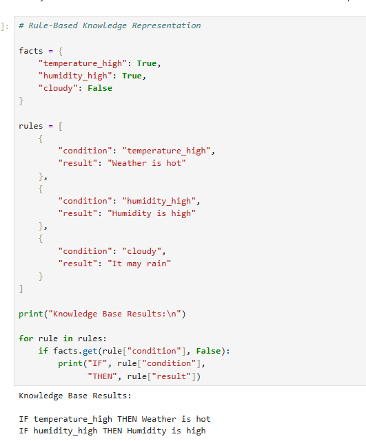
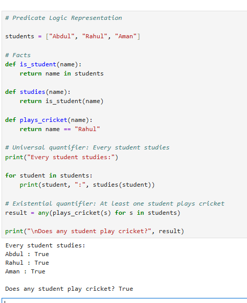
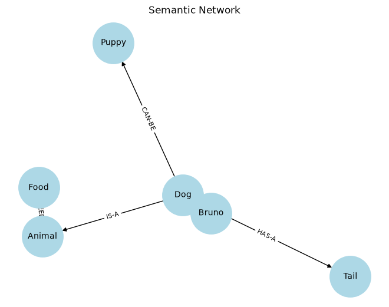
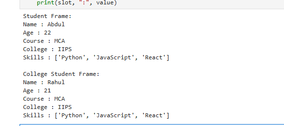
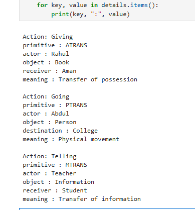
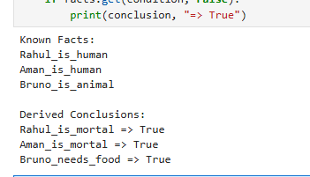

# Lab 4: Knowledge Representation & Logical Reasoning

## Overview

This lab focuses on representing knowledge in Artificial Intelligence using different techniques, including rule-based systems, predicate logic, semantic networks, frames, conceptual dependency, and logical inference.

The practical implementations are performed using Python in Jupyter Notebook.

## Objectives

- Understand the concept of Knowledge Representation.
- Implement Rule-Based Knowledge Representation.
- Represent facts and rules using Predicate Logic.
- Visualize relationships using Semantic Networks.
- Understand Frame Representation and inheritance.
- Represent actions using Conceptual Dependency.
- Implement a basic Logical Inference system.

## Technologies Used

- Python
- Jupyter Notebook
- NetworkX
- Matplotlib

## Practical Topics Covered

| No. | Practical                           | Description                                                  |
| --- | ----------------------------------- | ------------------------------------------------------------ |
| 1   | Rule-Based Knowledge Representation | Representing knowledge using IF-THEN rules.                  |
| 2   | Predicate Logic Representation      | Representing facts, predicates, variables, and quantifiers.  |
| 3   | Semantic Networks                   | Representing concepts and relationships using graphs.        |
| 4   | Frame Representation                | Organizing knowledge using frames, slots, and inheritance.   |
| 5   | Conceptual Dependency               | Representing the meaning of actions using primitive actions. |
| 6   | Logical Inference                   | Deriving conclusions from known facts and rules.             |

## Project Structure

```text
Lab4/
├── outputs/
│   ├── ConceptualDependency.png
│   ├── FrameRepresentation.png
│   ├── LogicalInference.png
│   ├── PredicateLogicRepresentation.png
│   ├── RuleBasedKnowledgeRepresentation.png
│   └── SemanticNetwork.png
└── KnowledgeRepresentation.ipynb
```

## Practical Outputs

### 1. Rule-Based Knowledge Representation

Implements an IF-THEN rule system that checks conditions and produces conclusions.



### 2. Predicate Logic Representation

Demonstrates predicates, facts, universal quantification, and existential quantification.



### 3. Semantic Networks

Visualizes concepts and their relationships using a directed graph.



### 4. Frame Representation

Demonstrates structured knowledge using frames, slots, values, and basic inheritance.



### 5. Conceptual Dependency

Represents actions and their meanings using conceptual dependency primitives such as ATRANS, PTRANS, and MTRANS.



### 6. Logical Inference

Demonstrates how an AI system derives conclusions from existing facts and logical rules.



## Installation and Execution

### 1. Install required libraries

```bash
python -m pip install jupyter matplotlib networkx
```

### 2. Launch Jupyter Notebook

```bash
jupyter notebook
```

### 3. Open the notebook

Open `Lab4/KnowledgeRepresentation.ipynb` and execute the cells sequentially.

## Learning Outcomes

After completing this lab, the following concepts were explored:

- Representing real-world knowledge in structured formats.
- Using rules and predicates to express logical information.
- Modeling relationships through semantic networks.
- Organizing knowledge using frames and inheritance.
- Understanding action representation through conceptual dependency.
- Deriving new information using logical inference.

## Conclusion

This lab provided practical exposure to different Knowledge Representation and Logical Reasoning techniques used in Artificial Intelligence. It demonstrated how information can be structured, relationships can be modeled, and conclusions can be derived using logical rules.
