# Lab 5: Machine Learning for Intelligent Decision Making

## Overview

This lab focuses on implementing Machine Learning techniques for intelligent decision-making using the Decision Tree Classification algorithm.

The practicals demonstrate how machine learning models learn patterns from datasets, make predictions, and evaluate their performance using different evaluation metrics.

All implementations are performed using Python, Jupyter Notebook, Pandas, Matplotlib, and Scikit-learn.

## Objectives

- Understand the fundamentals of Machine Learning.
- Create feature matrices and target variables.
- Implement Decision Tree Classification.
- Train models and make predictions.
- Evaluate model performance using accuracy, precision, recall, and F1-score.
- Generate and interpret confusion matrices.
- Visualize Decision Tree structures.

## Technologies Used

- Python
- Jupyter Notebook
- Pandas
- Matplotlib
- Scikit-learn

## Practical Topics Covered

| No. | Practical                    | Description                                                                      |
| --- | ---------------------------- | -------------------------------------------------------------------------------- |
| 1   | Student Placement Prediction | Predict student placement status using CGPA, aptitude, and backlogs.             |
| 2   | Disease Prediction           | Classify breast cancer samples as malignant or benign.                           |
| 3   | Loan Approval Prediction     | Predict loan approval decisions using applicant information.                     |
| 4   | Decision Tree Visualization  | Visualize Decision Tree structures and understand their decision-making process. |

## Project Structure

```text
Lab5/
├── outputs/
│   ├── DecisionTreeClassifierOutput.png
│   ├── DecisionTreeVisualization.png
│   ├── DiseaseClassificationReport.png
│   ├── DiseaseConfusionMatrix.png
│   ├── DiseaseDatasetOutput.png
│   ├── DiseasePredictionOutput.png
│   ├── LoanClassificationReport.png
│   ├── LoanConfusionMatrix.png
│   ├── LoanDatasetOutput.png
│   ├── LoanDecisionTreeVisualization.png
│   ├── LoanEncodedFeatures.png
│   └── LoanPredictionOutput.png
└── DecisionTree.ipynb
```

## Practical Implementations and Outputs

### 1. Student Placement Prediction

Implemented a Decision Tree Classifier to predict whether a student is likely to get placed based on CGPA, aptitude score, and backlogs.

**Techniques used:**

- Feature matrix creation
- Train-test splitting
- Decision Tree model training
- Placement prediction
- Accuracy evaluation

**Model Output**

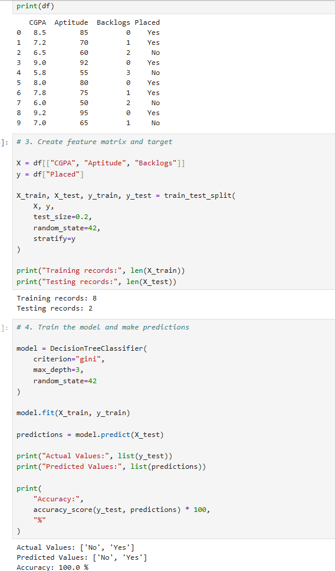

**Decision Tree Visualization**

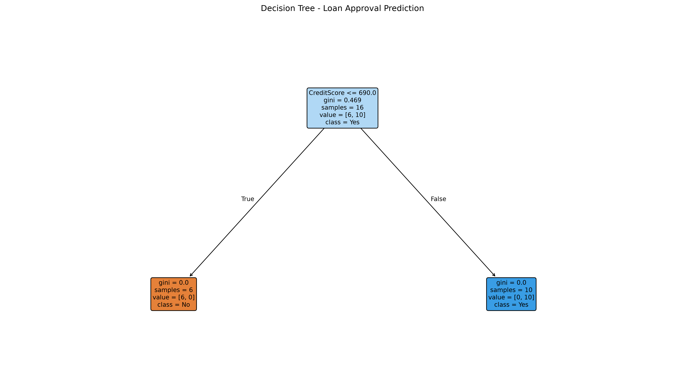

### 2. Disease Prediction

Implemented a Decision Tree Classifier using the Breast Cancer Wisconsin dataset to classify samples into malignant and benign categories.

**Techniques used:**

- Dataset loading
- Feature and target separation
- Decision Tree classification
- Confusion matrix
- Classification report

**Dataset Output**

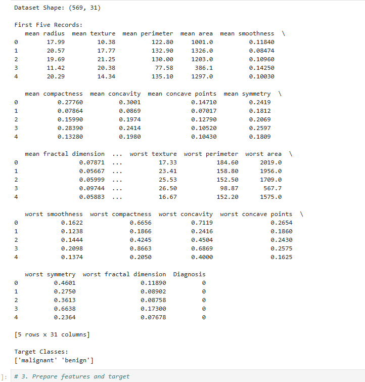

**Prediction Output**

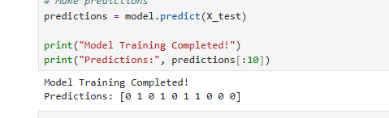

**Confusion Matrix**

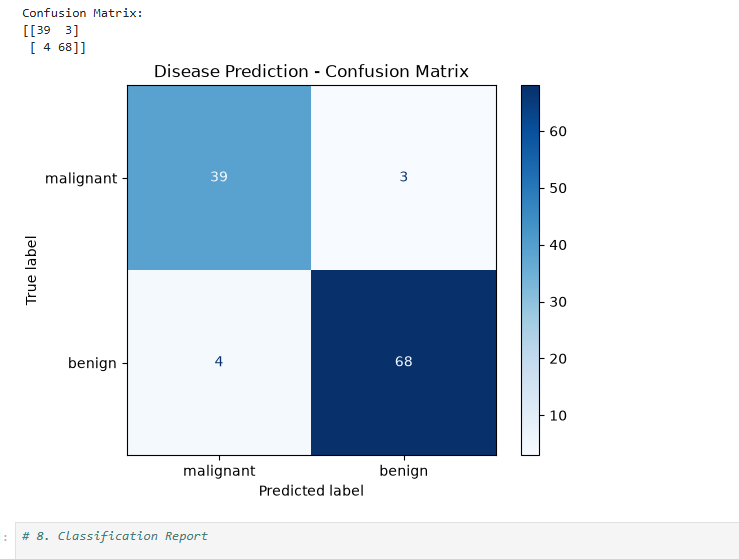

**Classification Report**

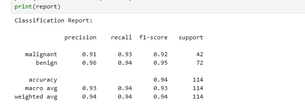

### 3. Loan Approval Prediction

Developed a Decision Tree Classification model to predict loan approval decisions using applicant information.

**Techniques used:**

- Feature encoding
- Train-test splitting
- Decision Tree model training
- Loan approval prediction
- Performance evaluation

**Dataset Output**

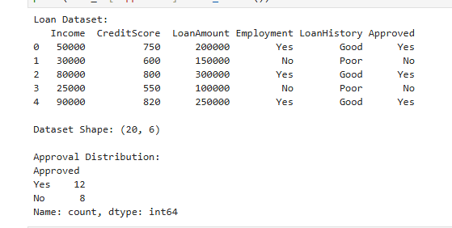

**Encoded Features**

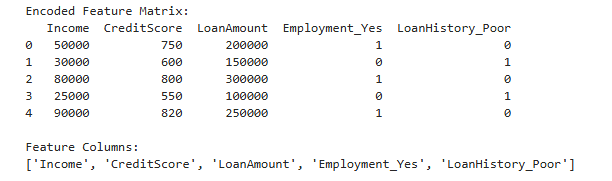

**Prediction Output**

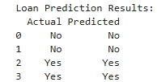

**Confusion Matrix**

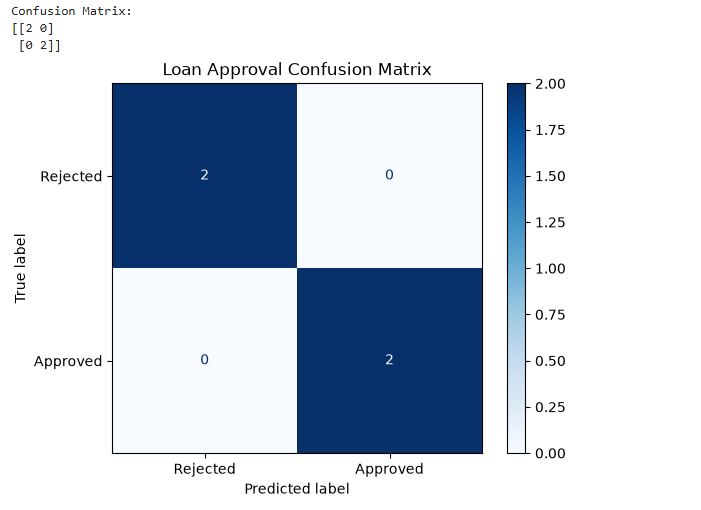

**Classification Report**

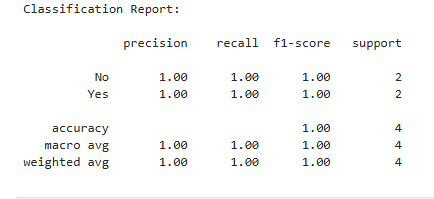

**Loan Decision Tree Visualization**

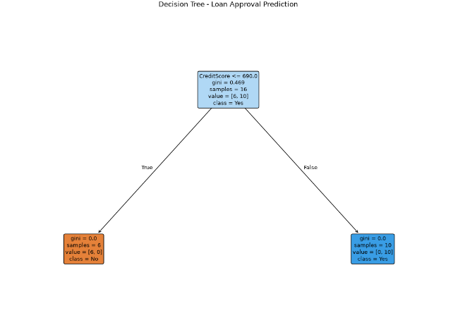

### 4. Decision Tree Visualization

Visualized the student placement Decision Tree using Scikit-learn's `plot_tree()` function.

The visualization displays:

- Root node
- Decision nodes
- Branches
- Leaf nodes
- Gini impurity
- Sample distribution


## Model Evaluation Metrics

| Metric           | Description                                                        |
| ---------------- | ------------------------------------------------------------------ |
| Accuracy         | Measures the overall percentage of correct predictions.            |
| Precision        | Measures the correctness of positive predictions.                  |
| Recall           | Measures how many actual positive cases were correctly identified. |
| F1-score         | Represents the balance between precision and recall.               |
| Confusion Matrix | Shows correct and incorrect predictions for each class.            |

## Installation and Execution

### 1. Install required libraries

```bash
python -m pip install jupyter pandas matplotlib scikit-learn
```

### 2. Launch Jupyter Notebook

```bash
jupyter notebook
```

### 3. Open the notebook

Open `Lab5/DecisionTree.ipynb` and execute the cells sequentially.

## Learning Outcomes

After completing this lab, the following concepts were explored:

- Understanding supervised machine learning.
- Creating feature matrices and target variables.
- Training and testing Decision Tree models.
- Applying classification to placement, disease, and loan prediction problems.
- Evaluating models using multiple performance metrics.
- Interpreting confusion matrices and classification reports.
- Visualizing Decision Tree structures.

## Conclusion

This lab provided practical experience with supervised Machine Learning using the Decision Tree Classification algorithm. Different prediction problems were implemented, and model performance was examined using evaluation metrics, confusion matrices, and tree visualizations.

The practicals demonstrated how machine learning models can support intelligent decision-making through data analysis, classification, prediction, and visualization.

**Note:** The student placement and loan approval datasets are small demonstration datasets. Their results should not be interpreted as evidence of real-world predictive performance. The disease classification practical is educational and is not intended for medical diagnosis.
