# Lab 6: PyTorch Basics and Neural Network Fundamentals

## Introduction

This lab focuses on understanding the fundamentals of Deep Learning and implementing basic neural network concepts using **PyTorch**.

PyTorch is an open-source deep learning framework used to build, train, and evaluate machine learning models. It provides tensor operations, automatic differentiation, neural network modules, loss functions, and optimization algorithms.

The practicals cover tensor manipulation, gradient computation, linear regression, neural network architecture, and model training and evaluation.

## Objectives

- Understand tensors and perform mathematical operations using PyTorch.
- Learn automatic differentiation and gradient computation.
- Implement linear regression using PyTorch.
- Understand the architecture and working of artificial neural networks.
- Train and evaluate a neural network model using PyTorch.

## Technologies Used

- **Programming Language:** Python
- **Deep Learning Framework:** PyTorch
- **Libraries:** Matplotlib, Pandas
- **Environment:** Jupyter Notebook

## Practical Experiments

### Experiment 1: Tensor Operations Using PyTorch

**Aim:** To create tensors and perform basic mathematical and matrix operations using PyTorch.

**Concepts Covered:**

- Creating scalar, vector, matrix, and multidimensional tensors.
- Understanding tensor dimensions, shape, data type, and size.
- Performing arithmetic operations.
- Matrix multiplication and aggregation operations.

**Output Screenshots:**

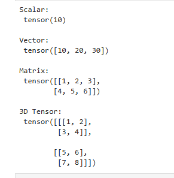

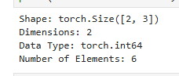

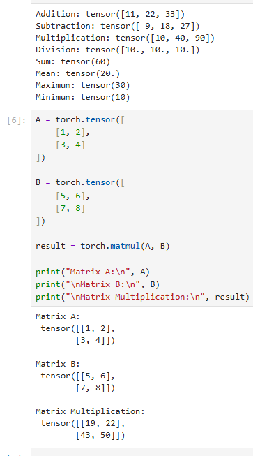

---

### Experiment 2: Automatic Differentiation and Gradient Computation

**Aim:** To understand automatic differentiation and calculate gradients using PyTorch's Autograd system.

**Concepts Covered:**

- Creating tensors with gradient tracking.
- Understanding `requires_grad`.
- Calculating derivatives using `backward()`.
- Accessing gradients through the `grad` attribute.
- Implementing gradient descent to minimize a function.

**Output Screenshots:**

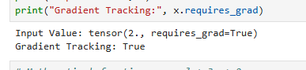

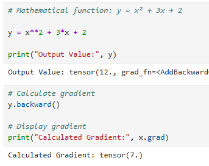

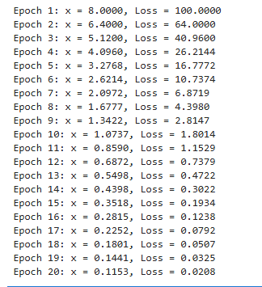

---

### Experiment 3: Linear Regression Using PyTorch

**Aim:** To implement a linear regression model using PyTorch and predict student marks based on study hours.

**Concepts Covered:**

- Preparing a dataset.
- Creating a linear model using `torch.nn.Linear`.
- Defining Mean Squared Error (MSE) loss.
- Optimizing model parameters using Stochastic Gradient Descent (SGD).
- Training the model and generating predictions.
- Visualizing actual data and the regression line.

**Output Screenshots:**

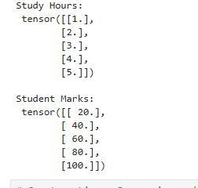

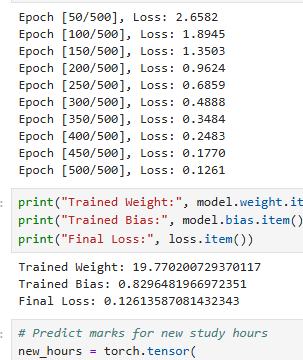

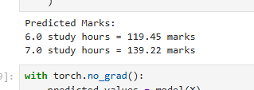

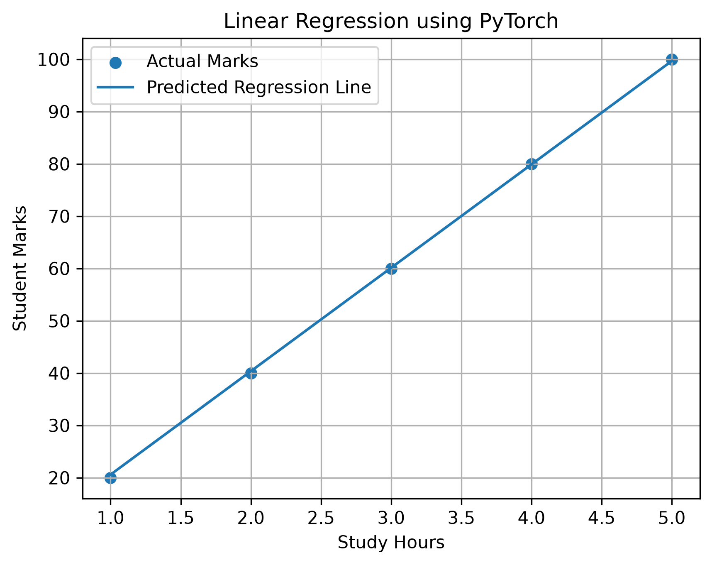

---

### Experiment 4: Neural Network Fundamentals

**Aim:** To understand the basic architecture and working of an Artificial Neural Network (ANN) using PyTorch.

**Concepts Covered:**

- Understanding input, hidden, and output layers.
- Creating a neural network using `torch.nn.Module`.
- Using Linear layers and ReLU activation.
- Understanding the Sigmoid activation function.
- Performing forward propagation.
- Generating predictions using the neural network.

**Output Screenshots:**

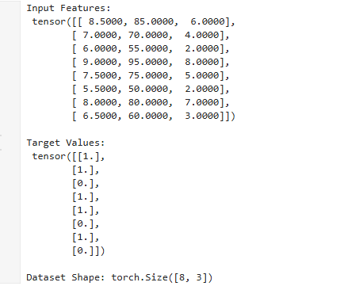

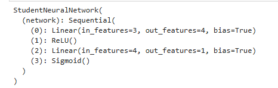

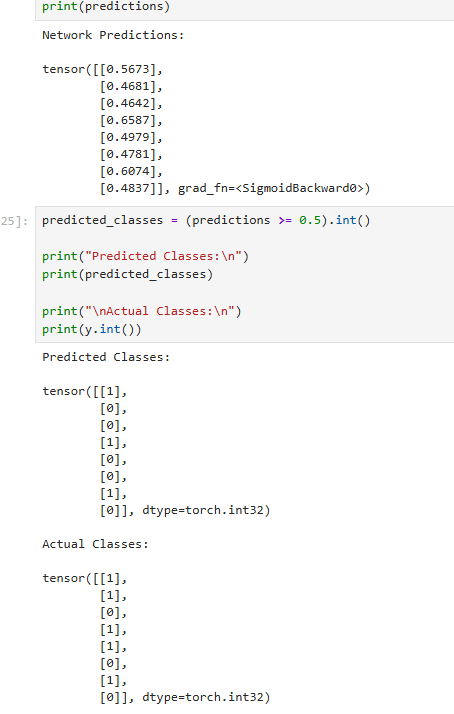

---

### Experiment 5: Model Training and Evaluation Using PyTorch

**Aim:** To train a neural network model using PyTorch and evaluate its performance on test data.

**Concepts Covered:**

- Preparing and splitting the dataset into training and testing sets.
- Normalizing input and output data using training-set statistics.
- Building a neural network model.
- Defining loss functions and optimizers.
- Implementing the training loop.
- Calculating gradients using backpropagation.
- Evaluating model performance using MAE and RMSE.
- Visualizing training loss and actual versus predicted values.

**Output Screenshots:**

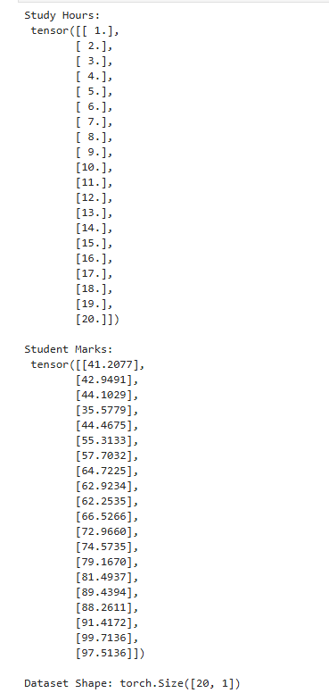

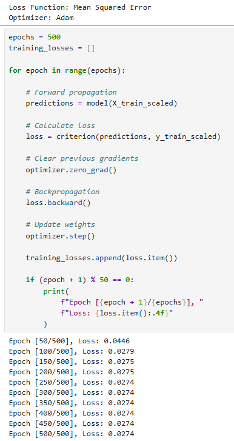

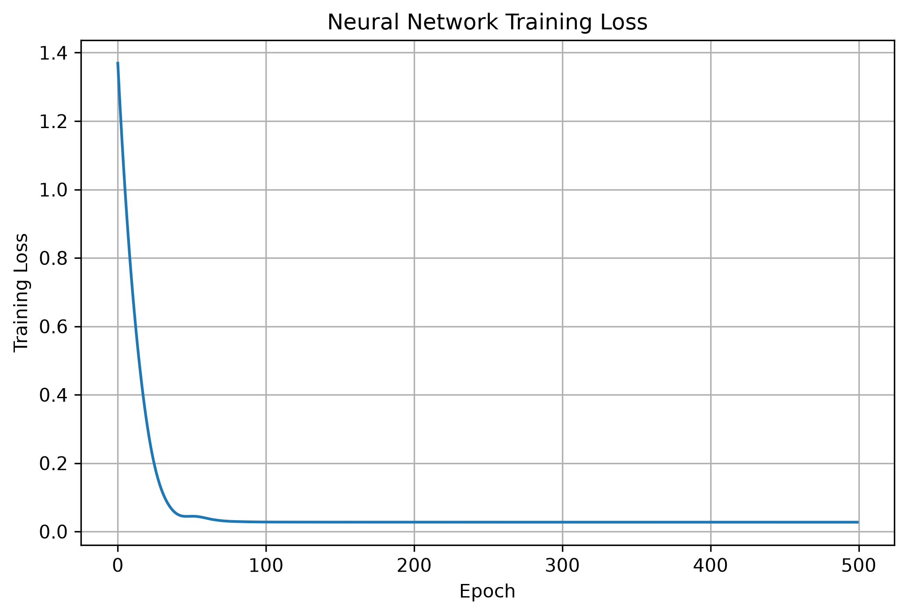

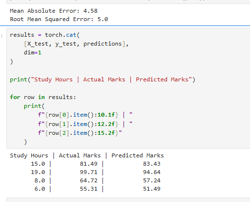

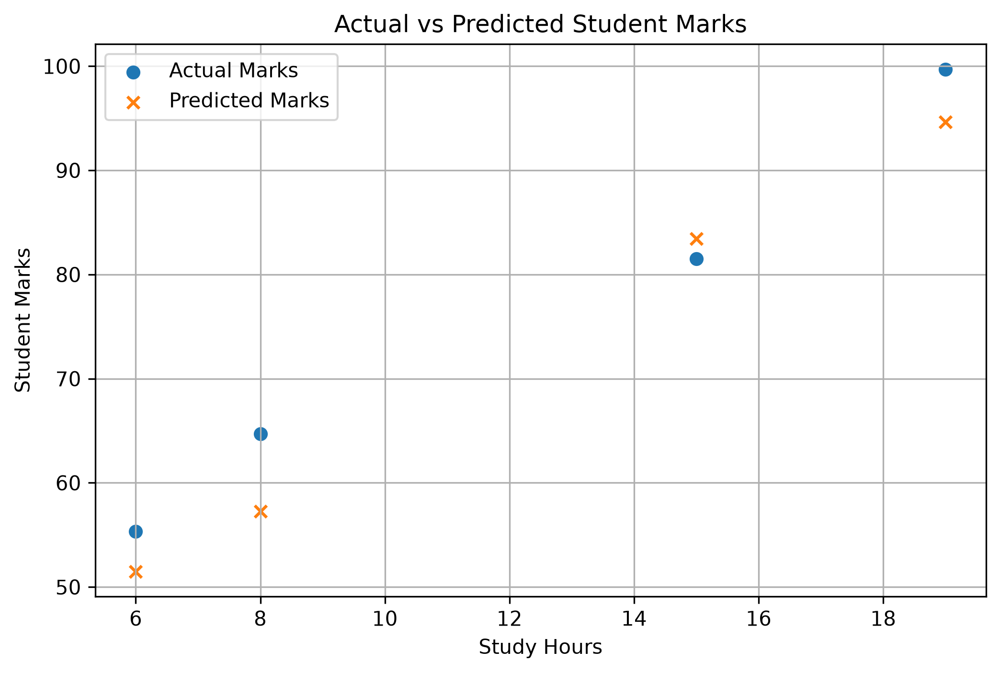

---

## Project Structure

```text
Lab6/
├── outputs/
│   ├── AutogradTensorOutput.png
│   ├── GradientCalculationOutput.png
│   ├── GradientDescentOutput.png
│   ├── LinearRegressionDataset.png
│   ├── LinearRegressionGraph.png
│   ├── LinearRegressionPrediction.png
│   ├── LinearRegressionTraining.png
│   ├── ModelEvaluationGraph.png
│   ├── ModelEvaluationOutput.png
│   ├── ModelTrainingDataset.png
│   ├── NeuralNetworkArchitecture.png
│   ├── NeuralNetworkDataset.png
│   ├── NeuralNetworkPrediction.png
│   ├── NeuralNetworkTraining.png
│   ├── TensorCreationOutput.png
│   ├── TensorOperationsOutput.png
│   ├── TensorPropertiesOutput.png
│   └── TrainingLossGraph.png
└── PyTorchBasics.ipynb
```

## Conclusion

In this lab, the fundamentals of PyTorch and Deep Learning were explored through practical implementations. Tensor operations and automatic differentiation were performed, followed by linear regression and neural network implementation. Finally, a neural network was trained and evaluated using performance metrics and graphical visualizations.

These experiments provided a basic understanding of how deep learning models are created, trained, and evaluated using PyTorch.
