# Lab 7: Explainable AI, Adversarial AI and Advanced Applications

## Introduction

This laboratory focuses on Explainable Artificial Intelligence (XAI), Adversarial AI, CNN-based image classification, and dimensionality reduction.

The experiments use a pretrained ResNet18 model for image classification, Grad-CAM for visualizing important image regions, and Fast Gradient Sign Method (FGSM) for generating adversarial examples. Principal Component Analysis (PCA) is also implemented to reduce dataset dimensions while preserving important information.

The final experiment combines image classification, model interpretability, and adversarial testing into a mini-project.

## Objectives

- Understand CNN-based image classification using ResNet18.
- Learn about pretrained models and transfer learning.
- Implement Grad-CAM for explaining image classification predictions.
- Generate adversarial images using FGSM.
- Evaluate model robustness against adversarial perturbations.
- Apply PCA for dimensionality reduction.
- Combine multiple AI techniques in a mini-project.

## Technologies Used

- **Programming Language:** Python
- **Deep Learning Framework:** PyTorch
- **Computer Vision:** Torchvision
- **Machine Learning:** Scikit-learn
- **Libraries:** NumPy, Pandas, Matplotlib, Pillow
- **Environment:** Jupyter Notebook

## Practical Experiments

### Experiment 1: ResNet-Based Image Classification

**Aim:** To perform image classification using a pretrained ResNet18 model and understand transfer learning.

**Concepts Covered:**

- Introduction to Convolutional Neural Networks (CNN).
- Understanding ResNet18 architecture and residual connections.
- Loading pretrained ImageNet weights.
- Understanding transfer learning.
- Image preprocessing and tensor conversion.
- Generating top-five classification predictions.
- Visualizing prediction confidence.

**Output Screenshots:**

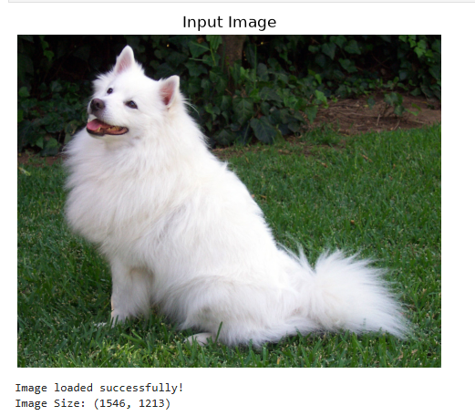

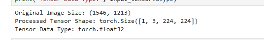

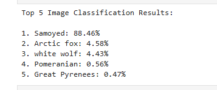

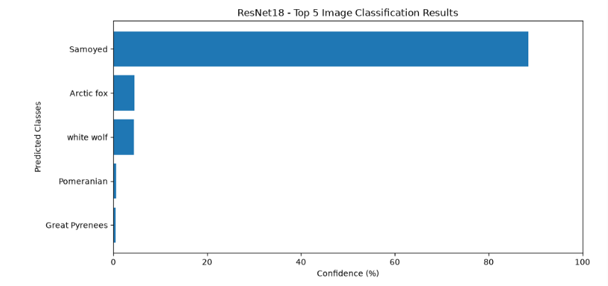

---

### Experiment 2: CNN Visualization Using Grad-CAM

**Aim:** To visualize important image regions influencing a CNN model's classification decision using Grad-CAM.

**Concepts Covered:**

- Introduction to Explainable Artificial Intelligence (XAI).
- Understanding Grad-CAM.
- Feature maps and gradients.
- Forward hooks and gradient hooks in PyTorch.
- Calculating feature-map importance weights.
- Generating class activation heatmaps.
- Visualizing important image regions.

**Output Screenshots:**

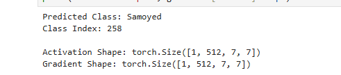

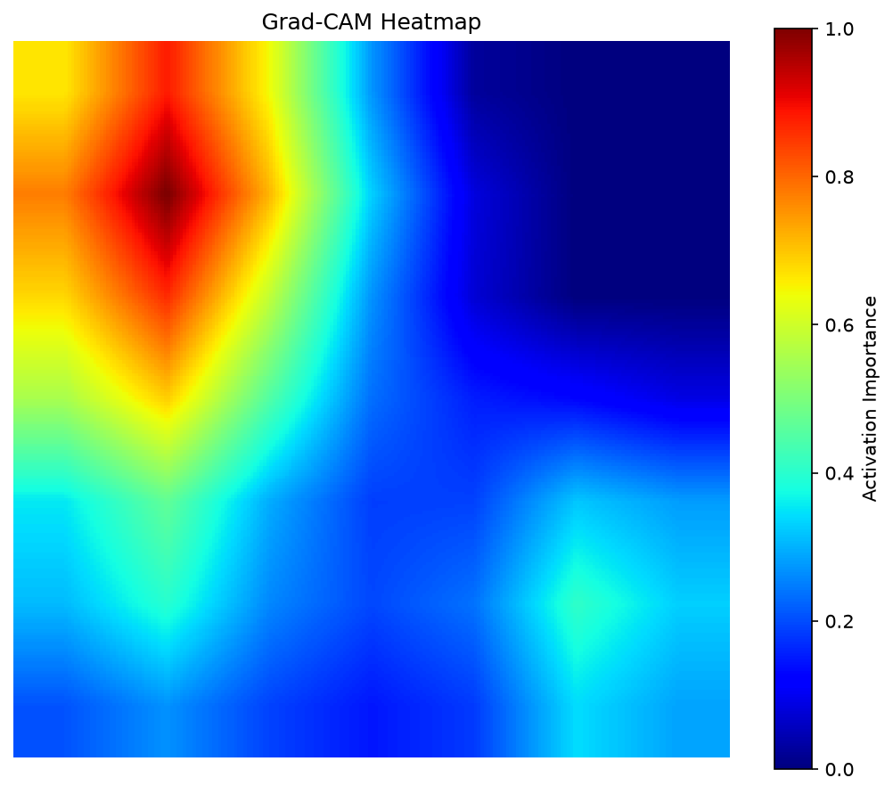


---

### Experiment 3: Adversarial Attack Using FGSM

**Aim:** To implement the Fast Gradient Sign Method (FGSM) attack and evaluate how small input perturbations affect image classification.

**Concepts Covered:**

- Introduction to Adversarial AI.
- Understanding adversarial examples.
- Fast Gradient Sign Method (FGSM).
- Gradient calculation with respect to input images.
- Generating adversarial perturbations.
- Comparing original and adversarial predictions.
- Evaluating robustness using different epsilon values.
- Visualizing perturbations and prediction confidence.

**Output Screenshots:**

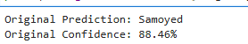

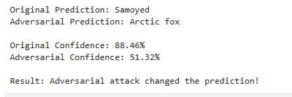

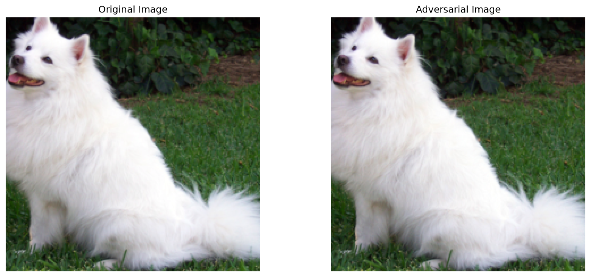

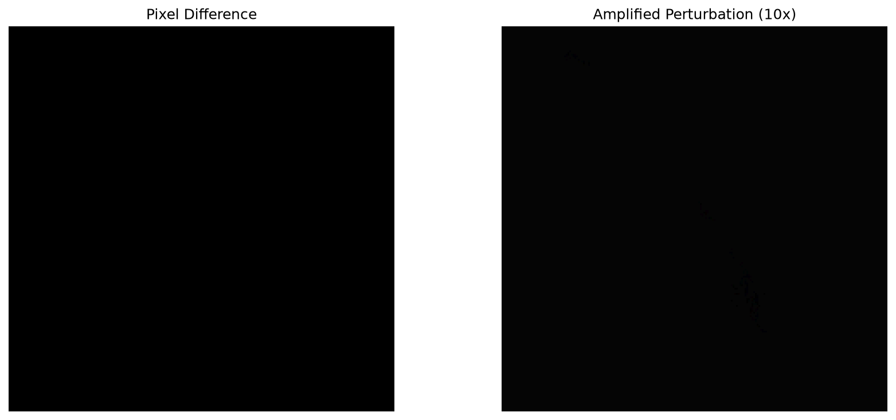

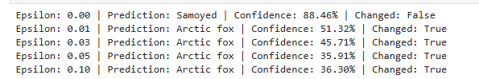

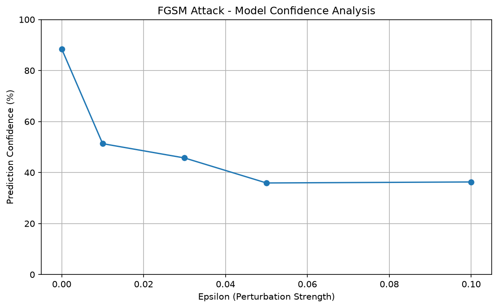

---

### Experiment 4: PCA for Dimensionality Reduction

**Aim:** To implement Principal Component Analysis (PCA) using Scikit-learn and reduce dataset dimensions while retaining important information.

**Concepts Covered:**

- Understanding dimensionality reduction.
- Introduction to Principal Component Analysis.
- Loading and analyzing the Iris dataset.
- Feature standardization using StandardScaler.
- Generating principal components.
- Calculating explained variance.
- Visualizing reduced-dimensional data.
- Comparing original and reduced feature dimensions.

**Output Screenshots:**

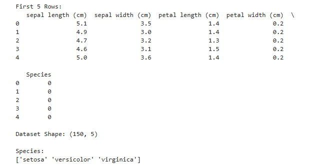

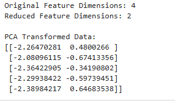

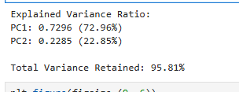

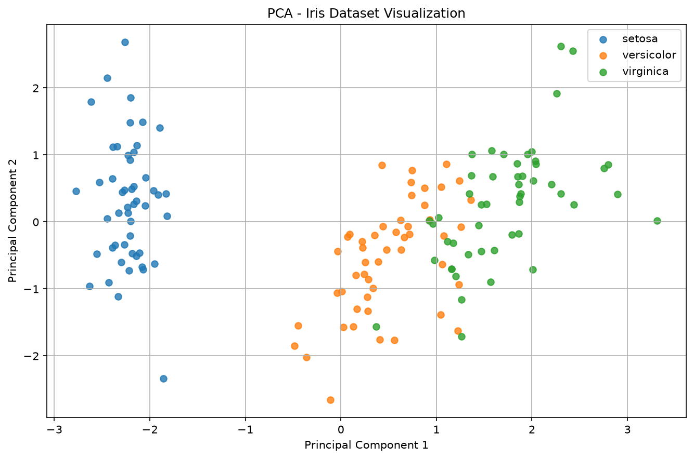

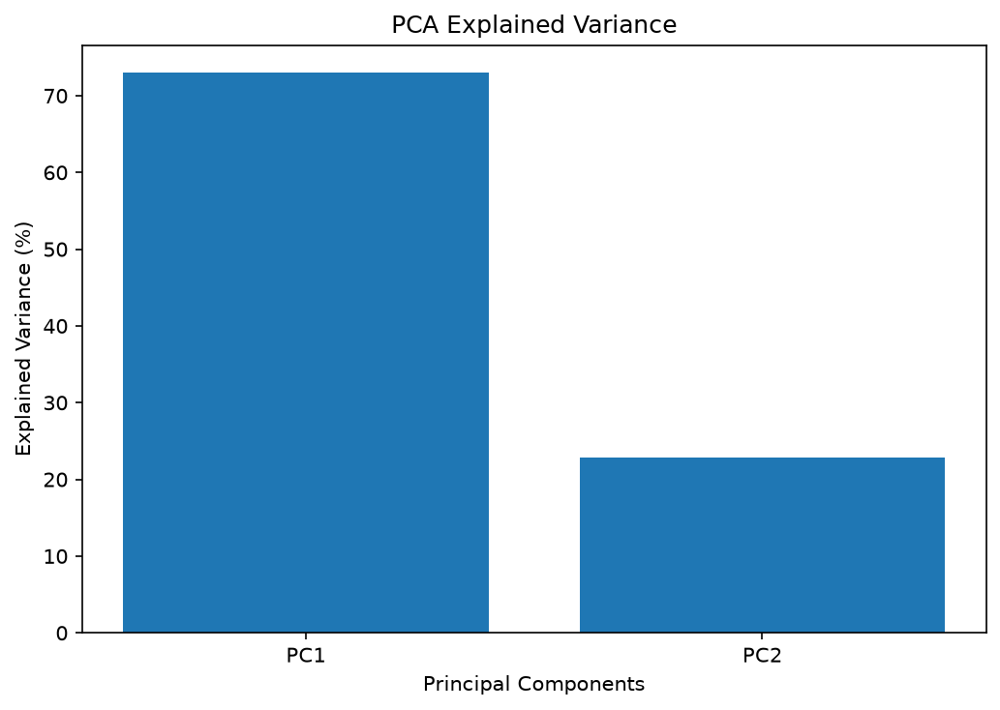

---

### Experiment 5: Mini Project - Explainable Image Classification

**Aim:** To develop an Explainable Image Classification system combining ResNet18, Grad-CAM, and FGSM to understand image classification, model interpretability, and model robustness.

**Concepts Covered:**

- Image classification using pretrained ResNet18.
- Model explanation using Grad-CAM.
- Generating adversarial images using FGSM.
- Comparing original and adversarial predictions.
- Visualizing image classification explanations.
- Evaluating robustness at different perturbation strengths.
- Analyzing prediction confidence.

**Output Screenshots:**

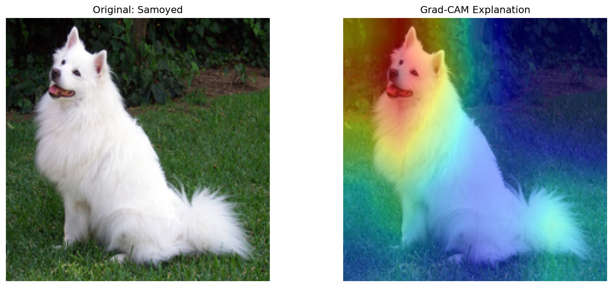

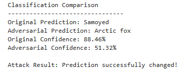


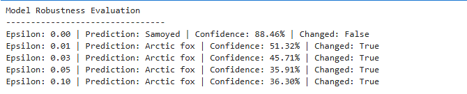

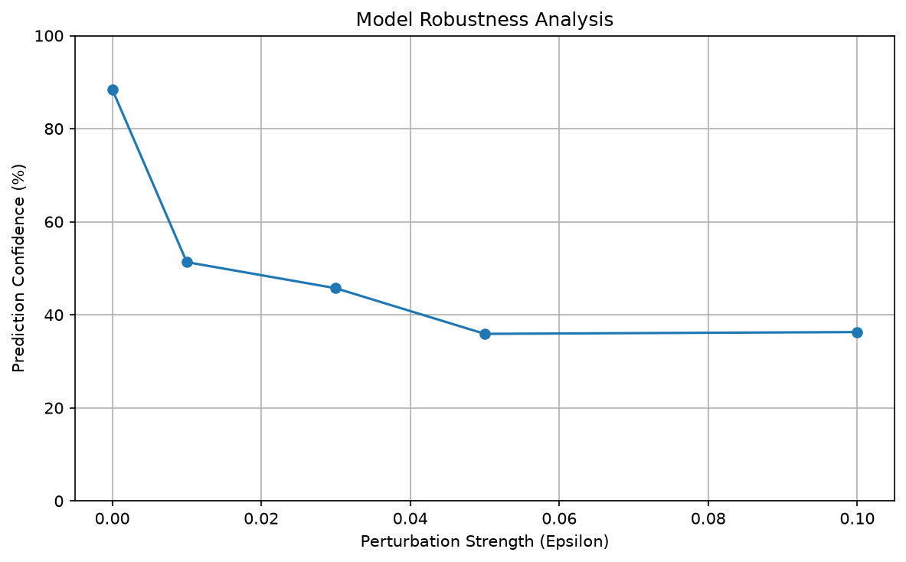

---

## Project Structure

```text
Lab7/
├── inputs/
│   └── dog.jpg
├── outputs/
│   ├── FGSMAdversarialPrediction.png
│   ├── FGSMImageComparison.png
│   ├── FGSMOriginalPrediction.png
│   ├── FGSMPerturbation.png
│   ├── FGSMRobustnessGraph.png
│   ├── FGSMRobustnessOutput.png
│   ├── GradCAMGradientOutput.png
│   ├── GradCAMHeatmap.png
│   ├── GradCAMOverlay.png
│   ├── MiniProjectGradCAM.png
│   ├── MiniProjectImageComparison.png
│   ├── MiniProjectPredictionComparison.png
│   ├── MiniProjectRobustnessGraph.png
│   ├── MiniProjectRobustnessOutput.png
│   ├── PCADatasetOutput.png
│   ├── PCAExplainedVariance.png
│   ├── PCAExplainedVarianceGraph.png
│   ├── PCAOutput.png
│   ├── PCAScatterPlot.png
│   ├── ResNetImagePreprocessing.png
│   ├── ResNetInputImage.png
│   ├── ResNetPredictionGraph.png
│   └── ResNetPredictionOutput.png
└── ExplainableAdversarialAI.ipynb
```

## Conclusion

In this laboratory, Explainable AI, Adversarial AI, image classification, and dimensionality reduction techniques were implemented using Python.

A pretrained ResNet18 model was used for image classification, Grad-CAM was applied to visualize important image regions, and FGSM was implemented to generate adversarial examples and evaluate model robustness. PCA was also used to reduce the dimensionality of the Iris dataset while retaining important information.

The final mini-project combined image classification, explainability, and adversarial testing into a single workflow. These experiments demonstrate the importance of building AI systems that are not only capable of making predictions but can also be interpreted and evaluated for robustness.

## Learning Outcomes

- Understood CNN-based image classification and transfer learning.
- Learned how pretrained ResNet models perform image recognition.
- Implemented Grad-CAM for visual model interpretation.
- Generated adversarial examples using FGSM.
- Evaluated model robustness under different perturbation strengths.
- Applied PCA for dimensionality reduction.
- Combined multiple AI concepts in a practical mini-project.
